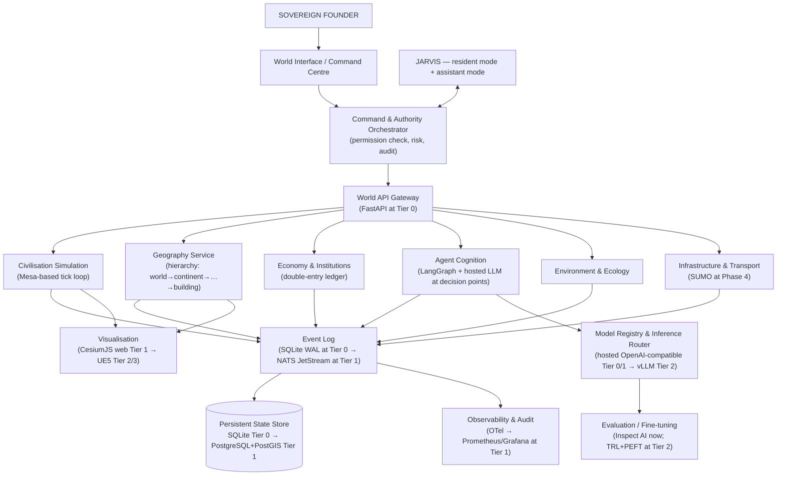
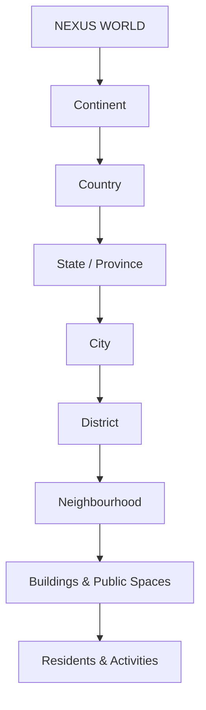
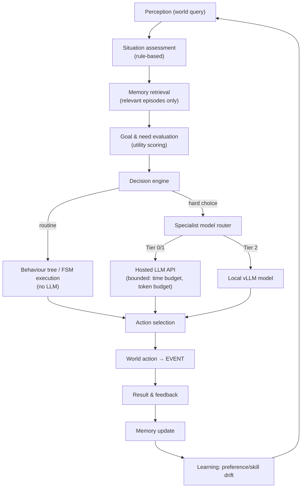
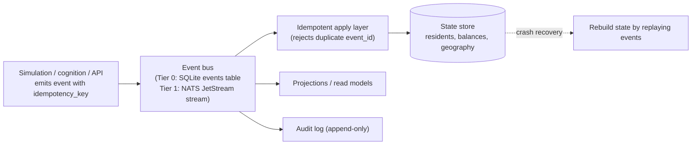
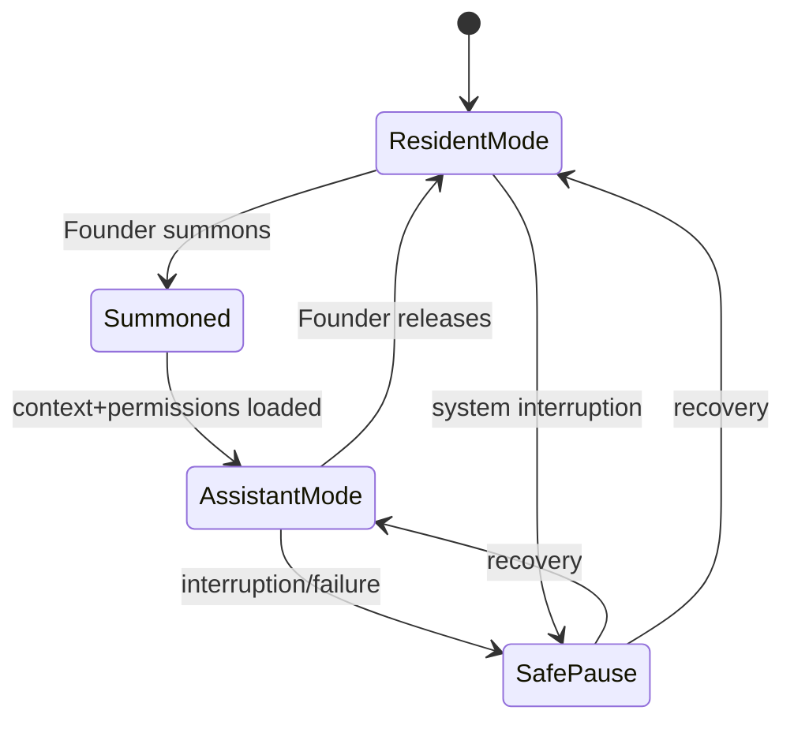
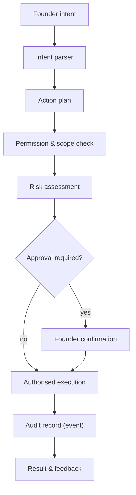
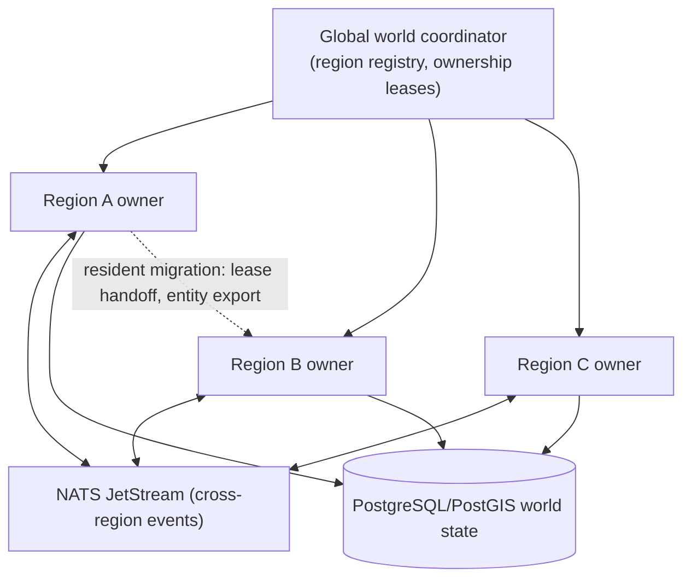

# NEXUS WORLD — Master Architecture (Phase 0 validated)

Status: PROPOSED architecture, validated against the audited Tier-0 hardware (2 cores / 3.9 GB RAM / 8 GB disk / no GPU) and the evidence in `research/RESEARCH_EVIDENCE_LEDGER.md`.
Version: 0.1.0 · Date: 2026-11-13

## 1. Governing principles (from spec, restated as constraints)

1. The rendered world is NEVER the authoritative source of state. Simulation runs headless and survives rendering-client disconnects (spec §10).
2. World truth, resident cognition, simulation execution, visual representation, AI inference, persistence, user interaction and administrative authority are separated (spec §10).
3. Every state change is an event; events are idempotent by key; state is rebuildable by replay (spec §30, §40 — pattern TESTED in Phase 0).
4. Hierarchical intelligence: deterministic rules first, utility/planning next, LLM only where cost is justified (spec §13).
5. Three hardware tiers; the same architectural boundaries at every tier, different runtimes (spec §34).

## 2. Layered architecture (validated target)

Design decisions vs. the spec's proposal: the structure is accepted unchanged; only the runtime bindings differ per tier. This is the architecture the evidence supports — nothing in it requires a GPU at Tier 0.

## 3. Three-tier deployment topology (spec §34)

| Tier | Hardware | Role | Key runtimes |
|---|---|---|---|
| **Tier 0 — Sandbox (CURRENT)** | 2 cores, 3.9 GB RAM, 8 GB disk, no GPU, Debian 13 | Authoritative simulation core + all logic development + tests | Python 3.12 stdlib, SQLite (WAL), FastAPI, Mesa, LangGraph (hosted LLM API), Inspect AI |
| **Tier 1 — Minimum viable production** | 8+ cores, 32 GB RAM, 500 GB SSD, still no GPU required | Persistent 24/7 world, web observation, monitoring | + PostgreSQL/PostGIS, NATS JetStream, Redis (optional), Prometheus+Grafana, Blender headless, CesiumJS tiles, OSM extracts |
| **Tier 2 — High-scale / GPU** | Workstation/server: 32+ cores or multi-node, 64–128 GB RAM, 1×24 GB+ VRAM GPU | Local model serving, fine-tuning, UE5 rendering, distributed regions | + vLLM or SGLang, TRL/PEFT/LLaMA-Factory, DeepSpeed (multi-GPU), Unreal Engine 5 (separate rendering host), Repast4Py/FLAME GPU 2 (distributed/GPU sim), CARLA |

Rules:
- Tier 0 code must run without modification on Tier 1 (SQLite→Postgres behind the same repository interface; JetStream behind the same event-bus interface).
- No torch-dependent package is installed at Tier 0 (disk budget: ~2 GB each).
- UE5 never gates simulation: it subscribes to world state via the rendering gateway.

## 4. World geography hierarchy (spec §12)

Storage: one adjacency list in the state store with node type, coordinates, elevation, terrain, land use, population; generated procedurally first (fictional geography), imported real-world geography (OSM extracts) kept in a **separate schema/database** for ODbL isolation (ADR-005).

## 5. Resident model and cognitive cycle (spec §13–14)

Resident state tree (persisted; details in `contracts/` at Phase 2): Identity, Age/LifeStage, Personality, Abilities, Knowledge, Beliefs/Preferences, Memories, CurrentGoals, LongTermGoals, Household, Relationships, Employment, Education, FinancialState, Health/Needs, Location, Schedule, CurrentActivity, DecisionHistory.

Cognition budgets (PROPOSED contract): per resident per simulated day — max 1 LLM call at LOD-0 (difficult decisions only), hard caps on tokens and latency, mandatory fallback to utility choice on timeout/error. Fluent language ≠ good decisions: goal-achievement metrics are logged per resident and reviewed (spec §14).

## 6. Event and persistence architecture (spec §30) — pattern TESTED

Verified by `tests/phase0_smoke_test.py`: duplicate delivery is a no-op; closed-system ledger invariant (sum of balances = 0); replay reconstructs identical state hash; deterministic rebuild.

## 7. World clock and simulation LOD (spec §32–33)

- World clock is a first-class entity: tick counter + simulated calendar + timezone per region; advances independently of any client. Tier 0: tick driven by the simulation process loop with catch-up after pause; Tier 1: scheduled worker.
- LOD levels (per spec): LOD 0 full cognition · LOD 1 simplified · LOD 2 statistical/aggregated · LOD 3 dormant/event-triggered. Promotion rules must preserve continuity (no impossible history — promotion materialises a consistent past from the statistical record).

## 8. JARVIS state machine (spec §25)

Invariants: summoning snapshots resident state (location, activity, schedule, relationships, pending commitments, memory) and restores it on release; assistant mode distinguishes simulated actions from real-world actions in every response; JARVIS reads only public or explicitly permitted private information (no omniscient access — enforced in the permission layer, spec §36).

## 9. Founder command authority (spec §35)

Action classes: observe · inspect · interact · simulate · modify world state · execute external action · irreversible action. The last two always require explicit confirmation at Tier ≥1; at Tier 0 (single-user sandbox) the check exists but auto-approves observe/inspect/simulate.

## 10. Distributed regional simulation (spec §31) — Tier 2 target

Tier 0/1 run single-owner (all regions in one process) behind the same interfaces, so the distributed tier is an execution detail, not an architecture change. Ownership transfer safety tests are a Phase 9 acceptance gate.

## 11. Required diagrams index (spec §37) — Phase 0 status

| # | Diagram | Status |
|---|---|---|
| 1 | Complete architecture | DONE (§2 above) |
| 2 | Geography hierarchy | DONE (§4) |
| 3 | Resident identity/data model | contract drafted at Phase 2 |
| 4 | Resident cognitive cycle | DONE (§5) |
| 5 | Daily-life lifecycle | Phase 2 (with vertical slice) |
| 6 | Social relationship graph | Phase 3 |
| 7 | Household/family structure | Phase 3 |
| 8 | Animal/ecological simulation | Phase 5 |
| 9 | Economy & supply chain | Phase 3 |
| 10 | Business lifecycle | Phase 3 |
| 11 | Multi-model training architecture | Phase 6 |
| 12 | Teacher–student distillation | Phase 6 |
| 13 | Model routing & inference | Phase 6 (stub in §5) |
| 14 | JARVIS state machine | DONE (§8) |
| 15 | Founder command architecture | DONE (§9) |
| 16 | Distributed regional simulation | DONE (§10, target design) |
| 17 | Entity migration | Phase 9 |
| 18 | Event & persistence architecture | DONE (§6) |
| 19 | Rendering/simulation separation | DONE (§2 + §3 rules) |
| 20 | Asset production pipeline | Phase 4 |
| 21 | World clock | DONE (§7, prose) |
| 22 | Simulation LOD | DONE (§7, prose) |
| 23 | Security & permissions | Phase 1 (with API contracts) |
| 24 | Monitoring & recovery | Phase 1/9 |
| 25 | Deployment topology | DONE (§3 table) |

Every DONE diagram above carries its components, interfaces, data flow and design decisions in the accompanying prose, per spec §37. Remaining diagrams are scheduled with the phase that produces the real system they describe — diagrams before systems would violate the spec's own rule ("Do not prioritise diagrams over working systems").
