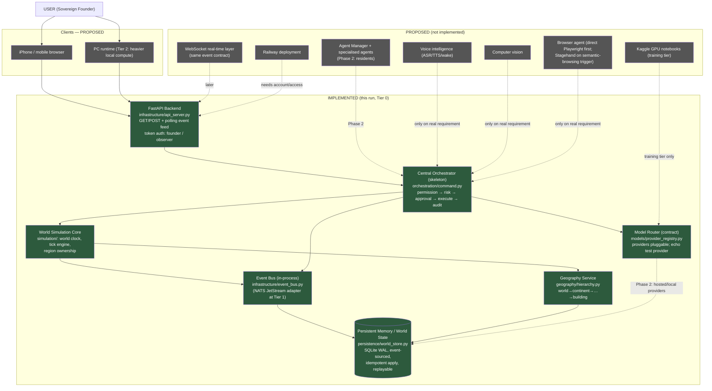

# JARVIS NEXUS — Architecture Audit, Repository Evaluation & Dependency Decision Report

Directive: "Master Engineering Directive: Existing Architecture Audit, Repository Evaluation, Dependency Elimination & Selective Integration" (Sovereign Founder, 2026-11-13).
Executed: 2026-11-13, together with NEXUS WORLD Phase 1 (the approved implementation stage).
Companion reports: `reports/PHASE0_TECHNICAL_AUDIT.md` (prior audit), `reports/PHASE1_REPORT.md` (this run's implementation report).

---

## A. Existing Architecture Inventory

**Audit method:** full filesystem inspection of the only project tree present (`NEXUS_WORLD/`, created in Phase 0 after discovering the environment contains no prior JARVIS NEXUS codebase — see Phase 0 report §1, limitation L-01), plus environment package inventory (`reports/PHASE0_HARDWARE_AUDIT.txt`). The directive's "established architectural foundation" table is treated as the mandated target architecture; the table below reports ACTUAL implementation status per component, exactly as the directive requires ("Do not confuse planned functionality with operational functionality").

| Component (directive) | Actual status | Location / evidence |
|---|---|---|
| Python backend | **Implemented (Phase 0–1)** — Python 3.12.16 | whole tree; smoke test 11/11 PASS (Phase 0) |
| FastAPI backend API | **Implemented this run (Phase 1)** | `infrastructure/api_server.py`; tests A9–A11 |
| SQLite persistent memory foundation | **Implemented + tested** — event-sourced store, WAL mode | `persistence/world_store.py`; Phase 0 `tests/phase0_smoke_test.py` 11/11; Phase 1 `tests/phase1_acceptance.py` |
| Model-provider abstraction | **Interface implemented this run** — registry + provider protocol + deterministic test provider; NO real providers yet (no credentials) | `models/provider_registry.py`; test M1–M3 |
| Central orchestrator | **Skeleton implemented this run** — permission → risk → approval → execute → audit, idempotent by command id | `orchestration/command.py`, `security/permissions.py`; tests C1–C5 |
| Agent registration | **Planned, absent** — arrives Phase 2 with residents (no duplicate registries exist) | — |
| WebSockets real-time | **Planned, absent** — Phase 1 exposes polling event feed (`GET /world/events`) as the contract; WS adapter later on same contract | `infrastructure/api_server.py` |
| Docker containerisation | **Absent — BLOCKED in sandbox** (no docker daemon, cannot install); deployment config deferred until a real deployment target exists (minimum-dependency rule: no speculative config) | blocker documented in §G |
| Railway deployment | **Absent — BLOCKED** (no Railway account, credentials or access in this environment) | §G blockers |
| PC runtime | **Partially mapped** — this 2-core sandbox IS the current PC-class runtime (Tier 0); heavier PC runtime = future Tier 2 | `docs/SYSTEM_REQUIREMENTS.md` |
| Kaggle GPU experimentation | **Not used yet** — no training requirement exists (all training tech DEFERRED); no accounts created | research ledger §2 |
| iPhone mobile access | **Planned, absent** — no mobile client code; API is the mobile-agnostic contract | — |
| Voice intelligence | **Planned, absent** — no voice stack installed (correctly: no voice requirement in Phase 1; no duplicate stacks introduced) | — |
| Computer vision | **Planned, absent** — no vision dependency introduced | — |
| Autonomous agents | **Planned, absent** — resident agents are Phase 2 | — |
| Cross-platform architecture | **Partially implemented** — API-first design (any HTTP client can consume); no platform-specific code | `infrastructure/api_server.py` |

**Duplication scan (directive Part 2):** no duplicated model routers, memory implementations, browser automations, speech engines, agent registries or event managers exist — because almost nothing exists yet. The only persistence path is the single event-sourced store; the only orchestrator is the single command orchestrator. The Phase 0 NEXUS_WORLD tree and this directive's JARVIS NEXUS architecture are **converged into ONE repository** (see ADR-006) — one orchestrator, one memory, one API — no parallel implementation was created.

## B. Capability Gap Analysis

Honest gaps, ranked by whether they block the project's current phase (Phase 1 world foundation + Phase 2 living residents):

| # | Genuine gap | Blocks | Filled by |
|---|---|---|---|
| G1 | No world foundation (clock, geography, events, identity, ownership) | Phase 1 | **Implemented this run** |
| G2 | No API layer to observe/control the world from any client | Phase 1 | **Implemented this run** (FastAPI — established decision, package already installed) |
| G3 | No model-provider contract (needed before ANY model integration, cloud or local) | Phase 2 | **Interface implemented this run**; real providers when credentials are supplied |
| G4 | No orchestrator/permission/audit spine for Founder commands | Phase 1 | **Implemented this run** (skeleton) |
| G5 | No LLM credentials/endpoint supplied | Phase 2 cognition | **BLOCKER — requires Founder input** |
| G6 | No always-on host; sandbox processes are ephemeral | 24/7 operation | Tier 1 hardware/Railway (BLOCKER — external) |
| G7 | No residents/agents, economy, social systems | Phases 2–3 | future phases (by design, not defects) |

**Gaps that do NOT exist** (manufactured gaps the directive warns against): browser automation (no requirement), 3D perception (no requirement), camera monitoring (no cameras), fine-tuning (no dataset/GPU), email (no requirement), avatars (no requirement), mobile agents (no requirement). Nothing was integrated to "fill" them.

## C. Repository Evaluation Matrix

Evidence gathered 2026-11-13 by two research agents from primary sources (raw LICENSE files, releases/commits Atom feeds, PyPI/npm registries, official docs; every URL in the agents' evidence lists). Format per directive.

| Technology | Existing equivalent | New capability | Compatibility | Deployment cost | Final decision |
|---|---|---|---|---|---|
| **RunAnywhere** (RunanywhereAI/runanywhere-sdks) | Model-provider abstraction (implemented); no local inference hardware | On-device inference SDK family (C++ core, 8 language SDKs, NPU/MLX/llama.cpp backends, `wally serve` OpenAI-compatible API) | Python SDK is **alpha and NOT published on PyPI** (verified 404); custom non-OSI licence (free only under $1M funding/revenue thresholds, verified from LICENSE) | Native toolchain; value concentrated on mobile/NPU/Apple hardware we do not have | **REJECT** — no demonstrable advantage over wiring permissively-licensed Ollama/llama.cpp (MIT) behind our existing provider abstraction when local hardware ever exists |
| **Stagehand** (browserbase/stagehand, MIT, v4.4.0 2026-11-04) | None (no browser automation in project); simplest baseline = direct Playwright | Self-healing `act()`, schema-validated `extract()`, `observe()`; local browser (no Browserbase cloud required); official Python SDK, first-class in v4; BYO-LLM callback fits our provider abstraction | Good: pure-Python deps (httpx/pydantic/websockets), no Node needed, MIT | One pip install + headless Chromium — but **zero browser-automation requirement exists today** | **DEFER** — designated upgrade path: adopt direct Playwright when deterministic browsing first appears; switch to Stagehand exactly when semantic/self-healing browsing becomes a real requirement |
| **CUT3R** (CUT3R/CUT3R, CVPR 2025 oral) | None | Streaming 3D scene reconstruction (metric pointmaps from video) | Research code: no releases, **dormant since 2025-08-27**, CUDA build (RoPE kernels), weights on Google Drive with UNVERIFIED licence | NVIDIA GPU effectively required; **CC BY-NC-SA 4.0 code licence — non-commercial, share-alike** (verified) | **REJECT** — not a project requirement; no GPU; non-commercial licence bars future commercial use; evidence retained on record |
| **Frigate** (blakeblackshear/frigate, MIT, 0.18.2 2026-10-15) | None (no vision system) | Full local NVR: 24/7 recording, object detection (Coral/Hailo/OpenVINO/TensorRT), MQTT `frigate/events` + REST integration surface | Integration surface is clean (MQTT/REST) **but** requires: Docker on a bare-metal LAN host, RTSP camera streams, AI accelerator recommended (CPU detector "not recommended" per docs), video storage volumes | Cannot run in this sandbox, on Railway CPU containers, or without cameras | **REJECT** — directive rule: keep only with real camera-monitoring intent AND hardware; neither exists. Revisit if cameras + always-on host appear (MQTT path documented) |
| **H2O LLM Studio** (h2oai/h2o-llmstudio, Apache-2.0, v1.15.4 2026-11-04) | Phase 0 ledger already shortlists TRL + PEFT (+ LLaMA-Factory GUI) for the future GPU tier | No-code GUI fine-tuning, experiment tracking, dataset connectors, Kaggle/RunPod paths | Standalone training workstation, not a service; outputs (merged HF models) would fit provider abstraction | **NVIDIA GPU mandatory, 128–256 GB+ system RAM, ≥24 GB VRAM recommended** (verified docs); not on PyPI | **DEFER** — directive's own rule: no fine-tuning requirement, dataset, or compatible GPU exists; would largely duplicate TRL+PEFT/LLaMA-Factory. Re-evaluate vs LLaMA-Factory only on a ≥24 GB-VRAM host |

**Part 4 exclusion list (per directive, one-line rationale each — none integrated):**
Pocket AI (mobile AI client — duplicates planned iPhone interaction), Live Avatar (avatar layer — voice/chat interaction sufficient, no avatar requirement), Duix Mobile (second mobile SDK — no mobile automation requirement), VisionDepth3D (depth estimation — no vision requirement), ArtCraft (creative tool — no requirement), GDevelop (game engine — rendering tier is already decided: CesiumJS→UE5; a game engine in the assistant core would be a competing orchestrator), DepthFlow (2.5D animation — no requirement), BillionMail (self-hosted email server — no email requirement; email delivery, if ever needed, is an external adapter), UTM (VM management — sandbox cannot run VMs; no requirement), Mobile-Agent (second mobile agent framework — no mobile automation requirement), Robot Arm (hardware control — no hardware), Input Overlay (UI tool — no requirement), F1 Race Replay (entertainment demo — no requirement), DrawDB (diagram editor — diagrams are maintained as Mermaid code in-repo), WorldGen (world generator — geography generation is implemented natively in Phase 1; a dependency would duplicate it), "GPT-4 as a repository" (category error: GPT-4 is a hosted model, accessed through the model-provider abstraction — never an architecture component; provider neutrality preserved).

## D. Final Dependency List

**RETAIN (existing, zero additions):**
- Python 3.12 stdlib (sqlite3, json, hashlib, uuid, random, datetime, asyncio)
- FastAPI 0.128.0 + Starlette 0.50.0 + Pydantic 2.12.5 (already installed — established architecture decision)
- uvicorn 0.44.0, httpx 0.28.1 (already installed — server + test client)
- Phase 0 decisions unchanged: Mesa (Phase 1 sim substrate — NOT yet installed, first pip install happens only when the tick loop needs it, and it is a pure-Python Apache-2.0 package), LangGraph/Inspect AI (Phase 2, with credentials), PostgreSQL/NATS (Tier 1 hardware)

**INTEGRATE (new, passed evaluation): NONE.**
Zero new dependencies this run — explicitly endorsed by the directive ("ZERO NEW DEPENDENCIES IS AN ACCEPTABLE AND SOMETIMES SUPERIOR RESULT"). Every candidate resolved to REJECT or DEFER on evidence.

**REJECT OR DEFER:**
- REJECT: RunAnywhere (unpublished Python SDK, threshold licence, no advantage), CUT3R (non-commercial, dormant, CUDA, no requirement), Frigate (no cameras/host, cannot run), Repast HPC (Phase 0: dormant since 2022), GPT-4-as-repository (category error)
- DEFER (with documented trigger conditions): Stagehand (trigger: semantic browsing requirement), H2O LLM Studio (trigger: ≥24 GB VRAM host + dataset + requirement), direct Playwright (trigger: any deterministic browsing requirement — simplest baseline), vLLM/SGLang/TRL/PEFT/DeepSpeed/LLaMA-Factory (trigger: Tier 2 GPU hardware), Temporal (trigger: multi-service durable workflows), UE5/CARLA/FLAME GPU (trigger: rendering/GPU tier)

## E. Architecture Diagram (implemented vs proposed)

Security boundaries (implemented): single API entry point; token-gated mutation endpoints (founder token via environment/config, observer = read-only); every command and its approval state appended to the append-only audit event log; idempotency keys prevent replayed execution. Proposed later: service-to-service auth (Tier 1), TLS at deployment boundary, rate limits.

Deployment locations (current reality): everything implemented runs in the Tier 0 sandbox (this machine); Railway/Kaggle/iPhone remain external targets with identified blockers (§G).

## F. Implementation Plan (approved changes = NEXUS WORLD Phase 1)

One approved change-set, executed immediately after this audit per the Founder's instruction ("proceed with phase one... so all is done together"):

| Aspect | Detail |
|---|---|
| Reason | Fill gaps G1–G4 (world foundation + API + provider contract + orchestrator spine) using ONLY established architecture components |
| Files created | `persistence/world_store.py`, `infrastructure/event_bus.py`, `infrastructure/api_server.py`, `geography/hierarchy.py`, `simulation/world_clock.py`, `simulation/tick_engine.py`, `simulation/region_ownership.py`, `security/permissions.py`, `orchestration/command.py`, `models/provider_registry.py`, `contracts/EVENTS.md`, `scripts/run_world.py`, `tests/phase1_acceptance.py` |
| Dependencies required | **None** (all installed already) |
| Architecture changes | Convergence ADR-006 (one repo, one orchestrator); no removals, no replacements — Phase 0 work preserved untouched |
| Deployment changes | None (Tier 0; no Docker/Railway changes — blocked and not required) |
| Security implications | Founder token auth on mutations; observer read-only; audit events for every command incl. rejections; idempotency keys on all state changes; no secrets in code (token injected via constructor/env) |
| Testing requirements | `tests/phase1_acceptance.py` against spec §40 acceptance criteria: restart survival, replay, duplicate rejection, entity identity, 120-tick determinism, clock correctness, geography integrity, ownership transfer, API-level restart survival, permission enforcement, provider registry behaviour |
| Rollback procedure | `git reset --hard 808f4eb` (Phase 0 baseline commit; repository initialised and committed before any change) |

## G. Verification Report

Executed 2026-11-13. Evidence: `reports/PHASE1_TEST_OUTPUT.txt` (48/48 checks, 265.3 ms, 2-core host), `reports/PHASE1_LIVE_SERVER_EVIDENCE.txt` (real HTTP over TCP), Phase 0 regression re-run (11/11). Statuses limited to Passed / Failed / Not tested / Blocked / Partially implemented:

| Component (from Part A) | Verification | Status |
|---|---|---|
| SQLite persistence (event-sourced, idempotent, replayable) | A2/A4/A5/A6/A7 + Phase 0 suite | **Passed** (restart survival, replay reconstruction, duplicate rejection, entity identity, determinism) |
| FastAPI backend API | D1–D10b + live uvicorn round-trip | **Passed** (create 201, duplicate 409, health 200, auth 401/403, tick idempotency 288/288, pagination, restart survival) |
| Central orchestrator (skeleton) | C1–C6, D9/D9b | **Passed** (role enforcement, approval gate for external actions, idempotent commands, complete audit log 7/7) |
| Model-provider abstraction | E1–E4 | **Passed** (contract-level only, via deterministic EchoProvider) — real providers **Not tested** (no credentials — blocker G5) |
| World simulation core (clock/geography/ownership) | A1/A3/A8/A9, B1–B5, CLI run | **Passed** (144 ticks = 1 day, tz/day-night/season, 8-level ancestry, no orphans, validated transfers, lease persistence) |
| Event bus fault isolation | F1 | **Passed** |
| Phase 0 regression | smoke suite re-run | **Passed** (11/11) |
| Agent registration | no implementation yet | **Not tested** (Phase 2 by plan) |
| WebSockets | not implemented; polling feed is the contract | **Not tested** (later phase) |
| Voice intelligence / computer vision | not implemented | **Not tested** (planned) |
| Docker | no docker daemon in sandbox, cannot install | **Blocked** (environment) |
| Railway deployment | no Railway account/credentials/access in this environment | **Blocked** (requires Founder to provide access or run deployment externally) |
| PC runtime beyond this sandbox | no other machine accessible | **Blocked** (external) |
| Kaggle GPU experimentation | no requirement yet (training deferred); no accounts created | **Not tested** (by decision) |
| iPhone/mobile client | none exists; API is client-agnostic | **Not tested** (planned) |
| Candidate integrations (RunAnywhere, Stagehand, CUT3R, Frigate, H2O) | evaluated on evidence, none installed | **Rejected/Deferred by decision** — nothing to test |

**Failures: none** in delivered scope. Two test-expectation errors were corrected during development (system code unchanged by them). No feature is reported operational beyond what the test output shows.
